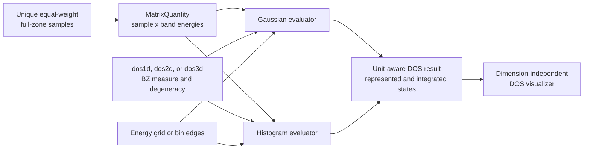

# Density-of-states schematics

## Ownership and evaluation



Mesh generation and band solving remain with the dimensional physical model.
The DOS owner starts from the resulting sampled energies.

## Dimensional normalization

```mermaid
flowchart TD
    D1[dos1d<br/>BZ reciprocal length]
    D2[dos2d<br/>BZ reciprocal area]
    D3[dos3d<br/>BZ reciprocal volume]
    SHARED[Shared equal-weight state factor<br/>g / ((2 pi)^d N)]
    OUT[DOS per energy per<br/>length, area, or volume]

    D1 --> SHARED
    D2 --> SHARED
    D3 --> SHARED
    SHARED --> OUT
```

## Navigation

- [Package index](index.md)
- [Numeric contract](numeric.md)
- [Scientific contract](scientific.md)
