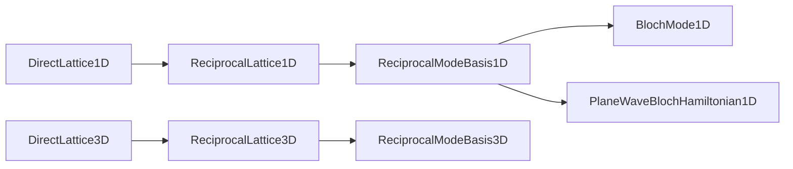

# Module `projectkoios.physkit.periodic.basis`

## Current responsibility

The module owns ordered finite reciprocal-mode bases for periodic fields.

- `ReciprocalModeBasis1D` correlates an explicit integer sequence with the canonical
  `periodic.lattice.ReciprocalLattice1D`.
- [`ReciprocalModeBasis3D`](ReciprocalModeBasis3D/index.md) correlates an explicit
  inventory of integer triplets with the canonical 3D reciprocal lattice.
- Reciprocal vectors are obtained through each lattice's `vector(...)` operation.
- Explicit construction preserves caller order and rejects duplicate modes.
- Symmetric-cutoff factories provide deterministic finite inventories.

## Nominal identity

Each basis accepts exactly one reciprocal-lattice owner for its dimension.

- Supported lattice identities are defined in `periodic.lattice` and exported from the
  package façade.
- The obsolete `periodic.reciprocal` module has been removed; the lattice package is
  the sole nominal owner.
- The 3D basis requires `periodic.lattice.ReciprocalLattice3D` exactly.
- Mode and vector arrays are copied into immutable integer and binary64 storage.
- The 1D and 3D basis identities are exported deliberately from `periodic`.

## Data flow

Canonical lattice operations supply vectors to represented modes and consumers.

- Direct-to-reciprocal construction precedes finite mode selection.
- Every physical vector retains the declared integer-mode order.

## Three-dimensional ordering

The 3D factory exposes one stable tensor-product convention.

- Cutoff `M` represents every triplet in `[-M, M]^3`.
- The first index is outermost, the second is middle, and the third is innermost.
- Cutoff zero represents the single reciprocal origin.
- Explicit construction may use any unique order needed by a consumer.
- Shifted wave vectors add one finite Cartesian three-vector to every basis vector.

## Exclusions

This tranche remains limited to represented basis identity.

- Lattice values retain the existing dimensionless lattice semantics.
- No 2D mode basis, reciprocal mesh, sewing map, Hamiltonian, frame, or hopping
  transform is introduced.
- No compatibility duplicate of the 1D reciprocal lattice is retained.
- Cutoff choice, convergence, material interpretation, and scientific validation remain
  outside the basis contract.

## Local mapping

Maintained source, consumers, and evidence remain explicit.

- Code: `src/python/projectkoios/physkit/periodic/basis.py`
- 1D mode consumer: `src/python/projectkoios/physkit/periodic/modes.py`
- Electronic consumers: `src/python/projectkoios/physkit/solidstate/electronic/`
- Basis tests: `tests/projectkoios/physkit/periodic/basis/`
- Façade tests: `tests/projectkoios/physkit/periodic/test__periodic_reciprocal_basis_public_api.py`
- [Parent package](../index.md)
