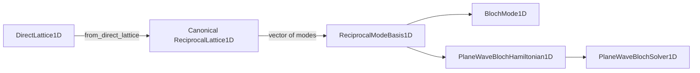

# Module `projectkoios.physkit.periodic.basis`

## Current responsibility

The module owns the finite ordered reciprocal-mode basis for one-dimensional periodic
fields.

- `ReciprocalModeBasis1D` retains the canonical public
  `periodic.lattice.ReciprocalLattice1D` by identity.
- An explicit nonempty inventory of unique integer modes fixes basis ordering.
- Reciprocal vectors are obtained through the lattice's `vector(...)` operation.
- `from_mode_limit(...)` constructs the symmetric inventory `-M, ..., M`.
- Shifted wave vectors represent `k + G_m` or `q + G_m` without assigning a field.

## Nominal identity

The basis has one reciprocal-lattice owner.

- The supported identity is defined in `periodic.lattice.lattice1d` and exported from
  both `periodic.lattice` and `periodic`.
- The legacy class in `periodic.reciprocal` is not accepted as a second nominal owner.
- The legacy module remains untouched in this tranche so compatibility disposition can
  be decided separately.
- Mode and vector arrays are copied into immutable binary64 or integer storage.

## Data flow

The canonical lattice operation supplies vectors to modes and electronic operators.

- Direct-to-reciprocal construction precedes finite mode selection.
- Both field modes and plane-wave Hamiltonians consume the same basis identity.

## Exclusions

This repair deliberately leaves broader representation decisions open.

- Lattice values remain dimensionless under the existing lattice contract.
- No KSD quantity, reciprocal mesh, sewing map, frame, or hopping transform is added.
- No two- or three-dimensional mode basis is implied.
- No completeness, cutoff convergence, material interpretation, or scientific
  validation is claimed.

## Local mapping

Maintained source, consumers, and focused evidence are explicit.

- Code: `src/python/projectkoios/physkit/periodic/basis.py`
- Mode consumer: `src/python/projectkoios/physkit/periodic/modes.py`
- Electronic consumers: `src/python/projectkoios/physkit/solidstate/electronic/`
- Tests: `tests/projectkoios/physkit/periodic/basis/`
- Mode tests: `tests/projectkoios/physkit/periodic/modes/`
- Electronic tests: `tests/projectkoios/physkit/solidstate/electronic/`
- [Parent package](../index.md)
