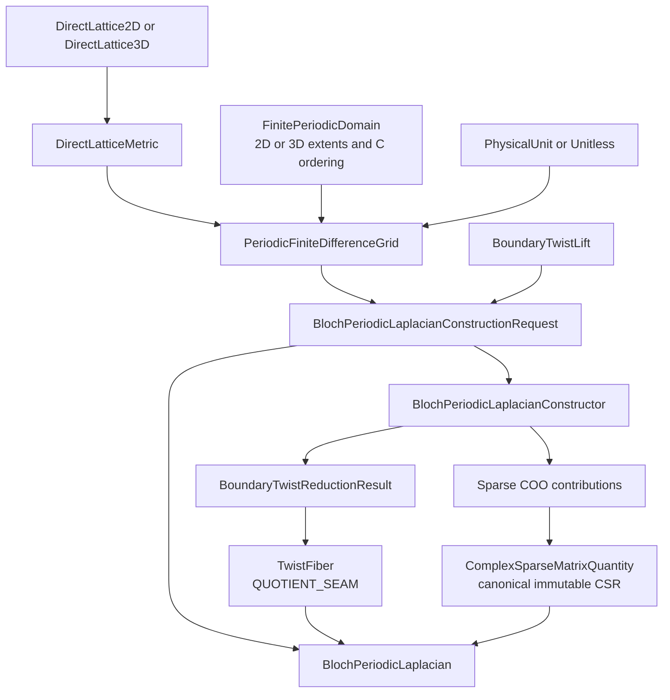
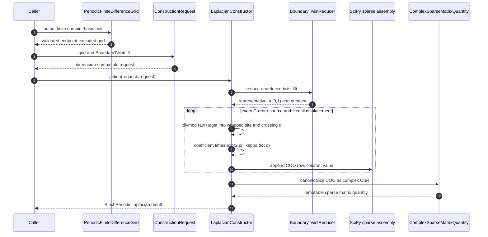
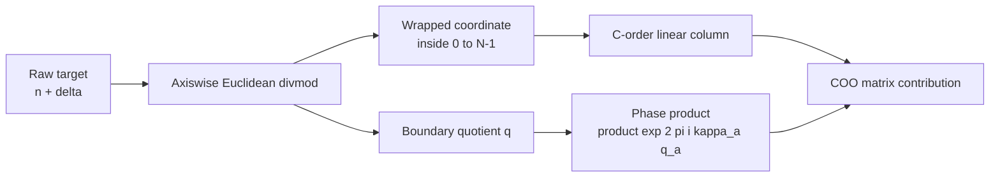
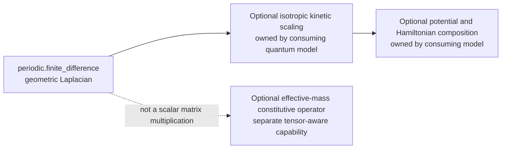

# Periodic finite-difference schematics

## Component relationships

## Construction sequence

## Index and seam mechanics

For shape `(N_0,...,N_{d-1})`, the C-order linear index is

$$
I(n_0,\ldots,n_{d-1})
=\sum_{a=0}^{d-1}n_a\prod_{b=a+1}^{d-1}N_b.
$$

A raw target is decomposed componentwise as

$$
\mathbf n+\boldsymbol\delta=\bar{\mathbf n}+N\mathbf q.
$$

The quotient-seam factor is

$$
\exp(2\pi i\,\boldsymbol\kappa\cdot\mathbf q)
=\prod_a\exp(2\pi i\kappa_aq_a).
$$

Simultaneous two-axis wraps therefore receive the product of both axis phases.

## Ownership boundary

The package ends at the geometric Laplacian. Kinetic scaling, anisotropic
constitutive tensors, potentials, and material interpretation remain separate.

## Navigation

- [Package index](../index.md)
- [Numerical page](../numerical/index.md)
- [Scientific page](../scientific/index.md)
