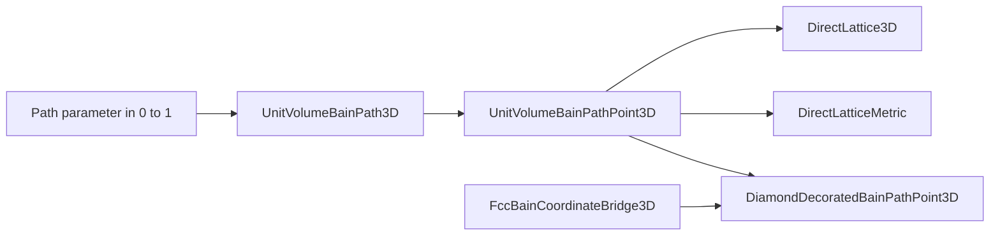

# Module `projectkoios.physkit.periodic.lattice.bain.path`

## Current responsibility

The module owns reusable crystallographic deformation-path representations and laws.

- [`UnitVolumeBainPath3D`](UnitVolumeBainPath3D/index.md) evaluates one explicit
  FCC-to-BCC Bain convention in a body-centered-tetragonal primitive basis.
- [`UnitVolumeBainPathPoint3D`](UnitVolumeBainPathPoint3D/index.md) retains correlated
  scalar and direct-lattice evidence at one path parameter.
- [`DiamondDecoratedBainPath3D`](DiamondDecoratedBainPath3D/index.md) carries a
  species-neutral two-site diamond fractional basis along that Bravais path.
- [`DiamondDecoratedBainPathPoint3D`](DiamondDecoratedBainPathPoint3D/index.md) retains
  the correlated Bravais and decorated-basis representations.
- The package façade deliberately exports all four identities.

## Bain convention

The represented path fixes its mathematical convention rather than selecting a
campaign.

- The closed path parameter runs from zero at the FCC endpoint to one at the BCC
  endpoint.
- The longitudinal-to-transverse ratio varies linearly from `sqrt(2)` to one.
- Transverse and longitudinal scales preserve unit primitive-cell volume.
- Primitive vectors use one declared body-centered-tetragonal orientation and ordering.
- Direct metrics and reciprocal geometry derive from the exact represented lattice.

## Data flow

The path action returns owner-native lattice geometry without campaign state.

- Evaluation constructs one correlated immutable point.
- The point owns a validated copy of its direct lattice.
- Metric construction remains on demand and owns a further validated copy.

## Ownership boundary

Crystallographic mechanics and scientific use remain distinct.

- PhysKit owns the path equation, endpoint convention, primitive-basis orientation,
  lattice construction, and invariant evidence.
- KSD or another consumer owns path sampling, campaign selection, thresholds,
  electronic response, diagnostics, artifacts, and acceptance.
- The unit-volume lattice is dimensionless; material scale and units are external.
- The path is a represented crystallographic model, not evidence of a material phase
  transition or transformation mechanism.

## Decorated structure

The diamond decoration is physical geometry rather than an electronic response model.

- Bain-basis fractional offsets are `(0, 0, 0)` and `(1/2, -1/4, 1/4)`.
- The exact FCC--Bain coordinate bridge restores `(1/4, 1/4, 1/4)` at the FCC endpoint.
- Cartesian offsets follow affinely from the current Bain direct basis.
- No atomic species, physical scale, Hamiltonian, or material endpoint is attached.

## Deferred crystallography

Related owner work remains intentionally separate.

- The area-preserving triangular-to-square rhombic path is a later 2D tranche.
- Generic homogeneous-deformation records require explicit active/passive and
  left/right-action conventions before introduction.
- Completion of this decorated path authorizes none of those successors.

## Local mapping

Source, tests, and provenance remain explicit.

- Code: `src/python/projectkoios/physkit/periodic/lattice/bain/path.py`
- Tests: `tests/projectkoios/physkit/periodic/lattice/bain/path/`
- [Parent package](../index.md)
- [Extraction provenance](../../../../../../../provenance/ksdft2effmass-crystallographic-paths.md)
