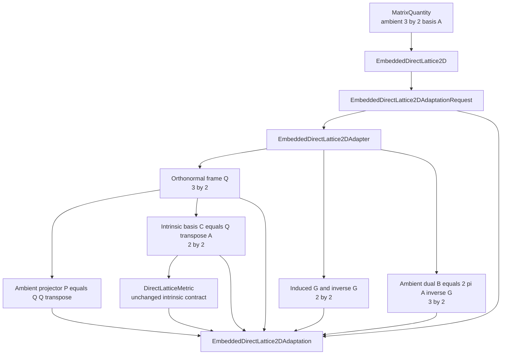
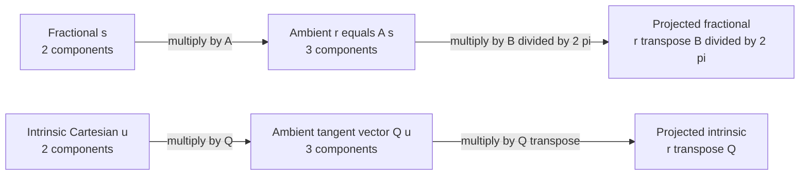
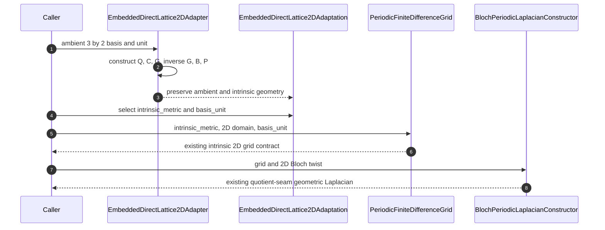
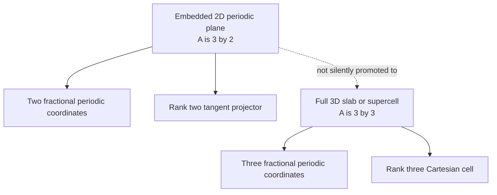
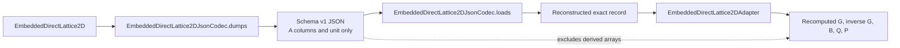

# Embedded 2D lattice schematics

## Ownership and adaptation

## Coordinate maps

## Reuse by the finite-difference capability

## Slab distinction

The adapter retains ambient orientation through `A`, `Q`, `P`, and `B`; only
the induced geometric operator is routed through the existing intrinsic `2×2`
metric contract.

## Strict serialization boundary

## Navigation

- [Module index](../index.md)
- [Numerical page](../numerical/index.md)
- [Scientific page](../scientific/index.md)
