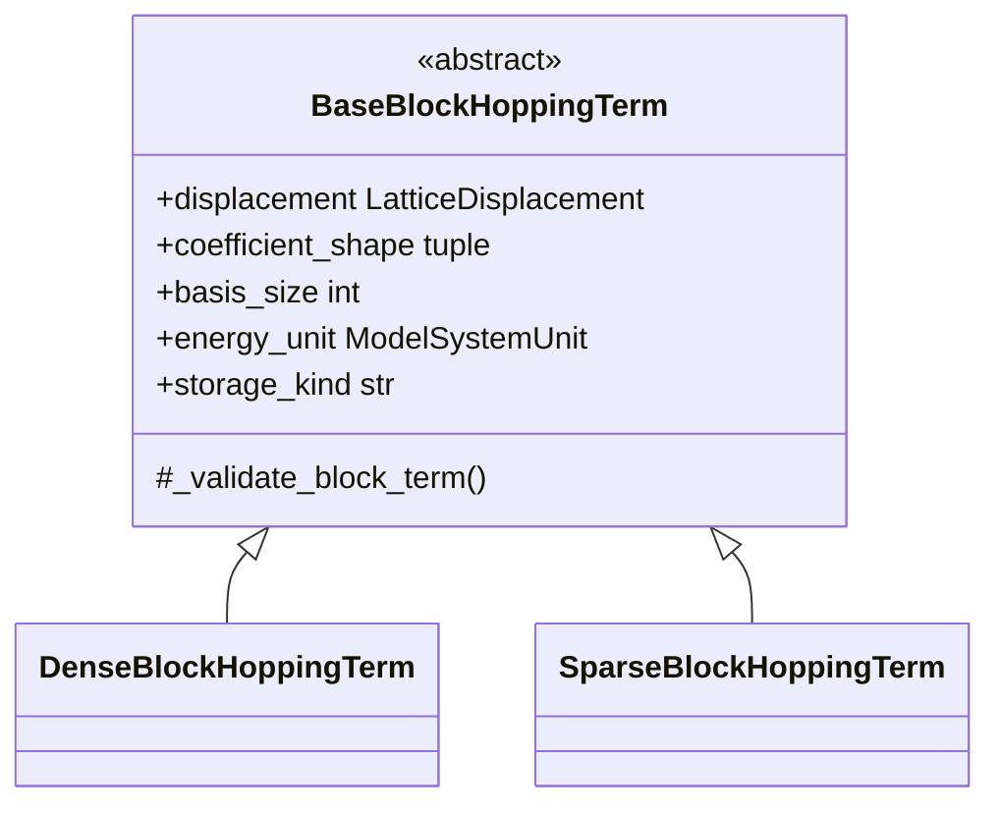

# `BaseBlockHoppingTerm` schematics

The base owns common behavior; concrete classes own exact coefficient
representations.

- [Index](index.md)
- [Numerics](numerics.md)
- [Scientific contract](scientifics.md)
