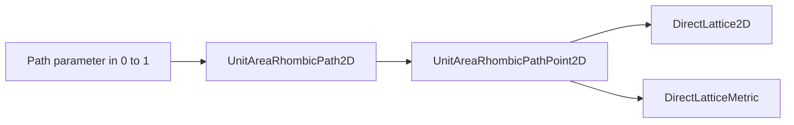

# Module `projectkoios.physkit.periodic.lattice.rhombic.path`

## Current responsibility

The module owns one explicit area-preserving 2D rhombic deformation path.

- [`UnitAreaRhombicPath2D`](UnitAreaRhombicPath2D/index.md) evaluates the path.
- [`UnitAreaRhombicPathPoint2D`](UnitAreaRhombicPathPoint2D/index.md) retains correlated
  scalar, lattice, area, and metric evidence.
- The direct basis uses a fixed positive-angle Cartesian orientation.
- The package façade deliberately exports both identities.

## Rhombic convention

The path varies primitive angle while preserving equal vector lengths and unit area.

- The closed path parameter runs from zero at the triangular endpoint to one at the
  square endpoint.
- The interior angle varies linearly from `pi/3` to `pi/2`.
- The common vector length is `1 / sqrt(sin(angle))`.
- The first vector lies on the positive Cartesian first axis.
- The second vector lies at the positive interior angle.

## Data flow

The path action returns owner-native lattice geometry without campaign state.

- Evaluation constructs one correlated immutable point.
- The point owns a validated `DirectLattice2D` copy.
- `DirectLatticeMetric` derives covariant, inverse, and reciprocal geometry on demand.

## Evidence limits

The path establishes represented crystallographic geometry only.

- Dense sampled tests bind the unit-area invariant and donor metric equation.
- Endpoint names identify lattice geometry under the declared basis convention.
- The action models no stress, energy, kinetics, temperature, or phase stability.
- Sampling and scientific acceptance belong to consumers.

## Local mapping

Source and focused verification remain adjacent.

- Code: `src/python/projectkoios/physkit/periodic/lattice/rhombic/path.py`
- Tests: `tests/projectkoios/physkit/periodic/lattice/rhombic/path/`
- [Parent package](../index.md)
- [Extraction provenance](../../../../../../../provenance/ksdft2effmass-crystallographic-paths.md)
