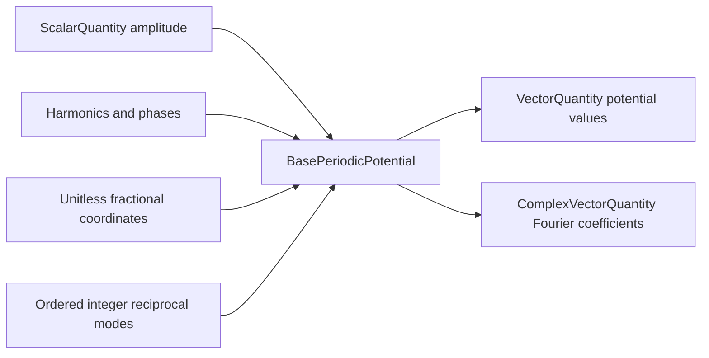
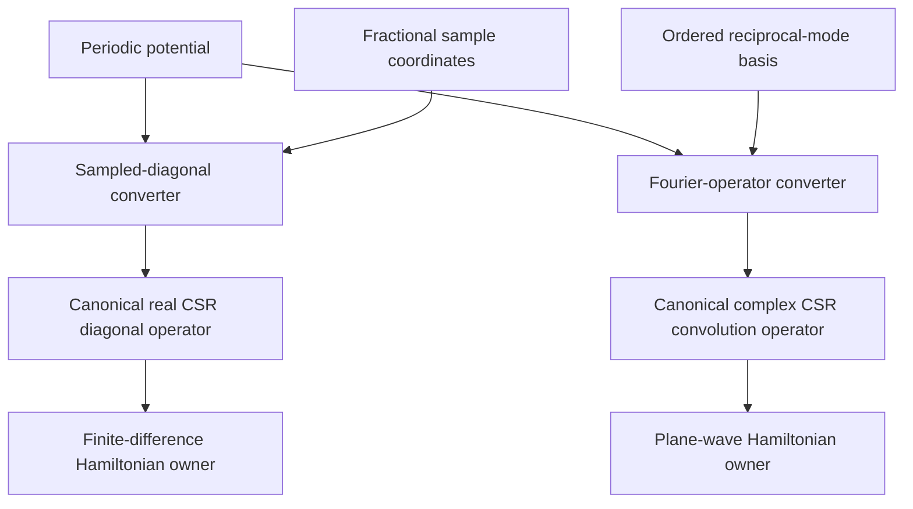
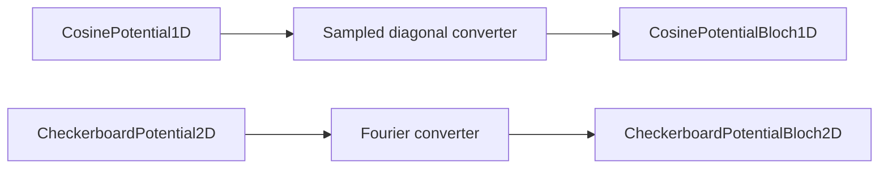

# Periodic-potential schematics

## Ownership boundary

The potential owns its scalar field and Fourier convention. The lattice owner
maps physical positions to fractional coordinates and supplies reciprocal-mode
identifiers.

## Potential-to-operator conversion

A converter does not add kinetic energy or solve an eigenproblem. Hamiltonian
owners compose the returned potential operator with their separately represented
kinetic operator.

## Current consumers

The three-dimensional cosine-product model is currently a reusable field and
operator source; it does not imply that a three-dimensional Bloch solver has
been selected or validated.

## Navigation

- [Package index](index.md)
- [Numeric contract](numeric.md)
- [Scientific contract](scientific.md)
