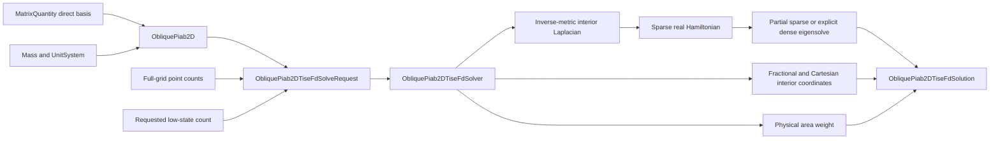

# Oblique PIAB2D finite-difference schematic

## Ownership boundary

`ObliquePiab2D` owns bounded direct-basis geometry and coherent physical
parameters. The solve request owns one discretization choice. The solver owns
representation and diagonalization. The solution correlates every numerical
array with that model and request.

The periodic finite-difference package is not reused because its
endpoint-excluded quotient topology and seam couplings represent a different
state space. Both packages reuse direct-lattice metric geometry only.
