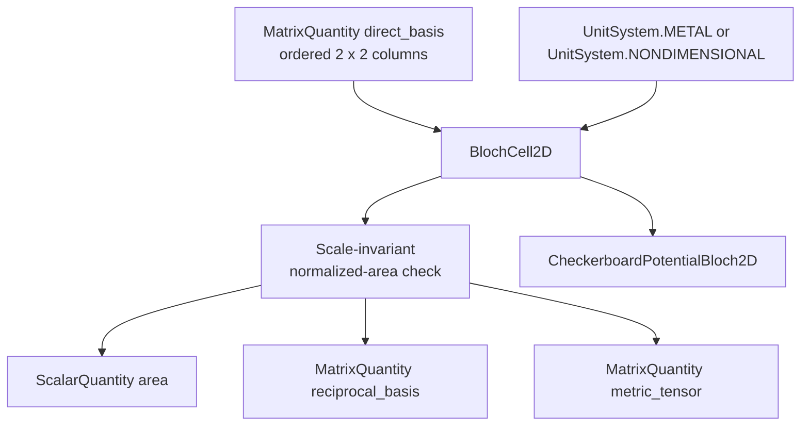
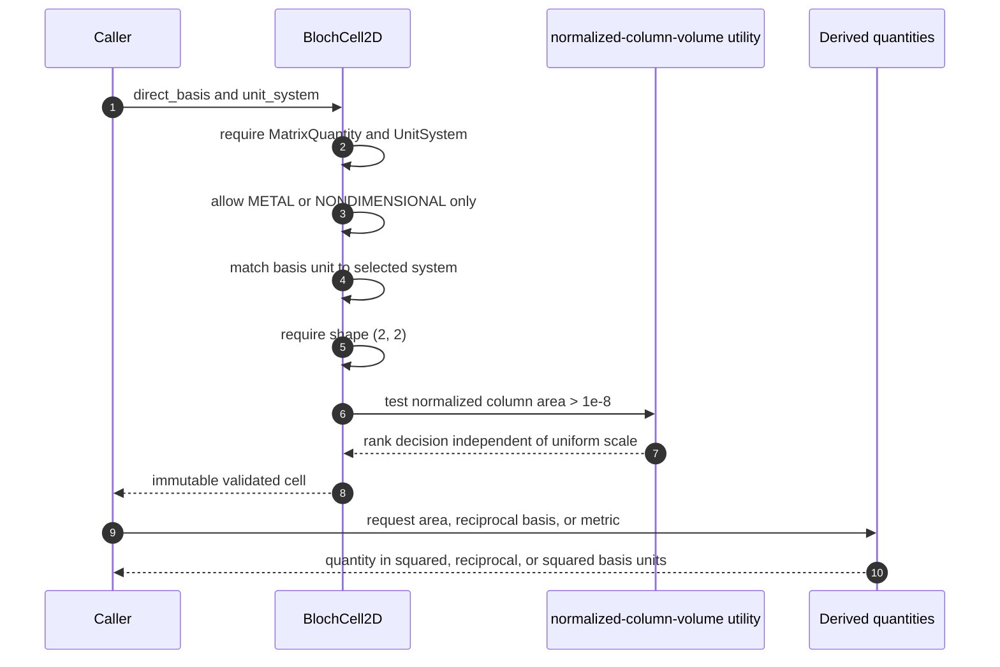
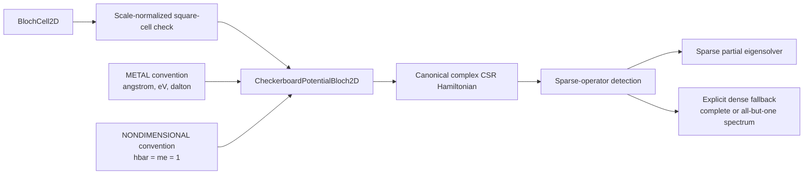

# `BlochCell2D` schematics

## Ownership and derived geometry

`BlochCell2D` owns represented geometry and units. It does not own a potential,
particle mass convention, reciprocal cutoff, band filling, or material label.

## Construction and validation sequence

## Consumer boundary

The checkerboard model adds a square-shape restriction. General `BlochCell2D`
geometry may be skew and is not itself restricted to square cells. The
Hamiltonian representation remains sparse by default; only eigensolver requests
outside the maintained ARPACK partial-spectrum range materialize a dense copy.

## Navigation

- [Module index](index.md)
- [Numeric page](numeric.md)
- [Scientific page](scientific.md)
