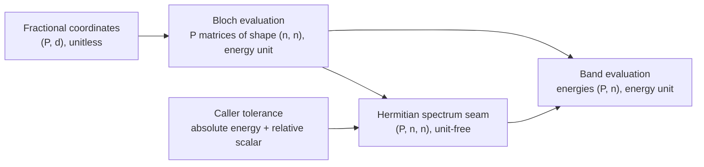

# Module `projectkoios.physkit.solidstate.tb.bands`

This page defines the reusable unit-aware block-band evaluation boundary.

## Current responsibility

The module maps matrix-valued hopping models and fractional reciprocal coordinates
to complete, ascending, unit-aware energy bands.

- `BlockHoppingBlochEvaluator` supplies the authoritative Bloch matrices.
- Caller-supplied tolerances control numerical Hermiticity validation.
- The Hermitian representative is explicitly $(A+A^\dagger)/2$.
- `BlockHoppingBandEvaluation` retains matrices, bands, diagnostics, and backend
  evidence as one correlated result.
- No scientific tolerance, gap, fit, error, convergence, or acceptance policy is
  selected.

## Numerical definitions

Each point diagnostic reports maximum-absolute quantities in the model energy unit.

- `input_matrix_maximum_absolute_entry` is $\max_{ij}|A_{ij}|$.
- `input_hermiticity_maximum_absolute_defect` is
  $\max_{ij}|A_{ij}-A_{ji}^*|$.
- `applied_hermiticity_cutoff` is $a+r\max_{ij}|A_{ij}|$ for absolute tolerance
  $a$ and relative tolerance $r$.
- `representative_adjustment_maximum_absolute_defect` is
  $\max_{ij}|[(A+A^\dagger)/2]_{ij}-A_{ij}|$.
- Defect equality with the cutoff passes; only a strictly larger defect rejects the
  whole batch.
- Accepted representatives are exactly Hermitian.
- Nonfinite arithmetic or output raises `FloatingPointError`.
- Eigensolver nonconvergence raises `RuntimeError`.

## Data flow and shapes

The diagram records the unit boundary and the correlation among coordinates,
matrices, diagnostics, and complete spectra.

- `P` is the reciprocal-point count.
- `d` is the lattice dimension.
- `n` is the ordered-basis size.
- Row `p` of the band matrix corresponds to coordinate row `p`, Bloch matrix `p`,
  and point diagnostic `p`.
- Empty input retains `n`, returns band shape `(0, n)`, uses empty point diagnostics
  and `diagnostics=None`, and skips linear algebra.

## Numerics owner boundary

The pinned `projectkoios.numerics.linalg.hermitian_spectrum` capability owns the
generic unit-free batch-spectrum operation.

- PhysKit constructs `BatchedHermitianSpectrumDefinition` directly.
- Empty batches use `BatchedHermitianSpectrumDefinition.empty` to retain `n`.
- `BatchedHermitianSpectrumTolerance` receives unit-stripped numerical values.
- `NumpyBatchedHermitianSpectrumSolver` executes the complete-spectrum operation.
- Each accepted nonempty batch uses one public
  `numpy.linalg.eigvalsh(..., UPLO="L")` call.
- No per-point eigensolver loop is hidden inside the adapter.
- Empty batches retain backend declaration evidence without invoking NumPy linear
  algebra.
- PhysKit restores energy units to spectra and both levels of diagnostics.

## Exclusions

The module reports reusable computational facts rather than consumer-specific
scientific interpretation.

- No band-gap or selected-band policy is present.
- No fit window, locality metric, or KSD error metric is present.
- No scientific cutoff, convergence criterion, or acceptance status is inferred.
- No cyclic displacement equivalence or finite-mesh Nyquist rule is inferred.

## Navigation

The pages below describe each public record and action.

- [`BlockHoppingBandTolerance`](BlockHoppingBandTolerance/index.md)
- [`BlockHoppingBandPointDiagnostics`](BlockHoppingBandPointDiagnostics/index.md)
- [`BlockHoppingBandDiagnostics`](BlockHoppingBandDiagnostics/index.md)
- [`BlockHoppingBandEvaluation`](BlockHoppingBandEvaluation/index.md)
- [`BlockHoppingBandEvaluator`](BlockHoppingBandEvaluator/index.md)
- [Parent package](../index.md)

## Local mapping

The maintained implementation and tests remain explicitly mapped.

- Code: `src/python/projectkoios/physkit/solidstate/tb/bands.py`
- Tests: `tests/projectkoios/physkit/solidstate/tb/bands/`
