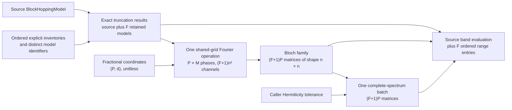

# Module `projectkoios.physkit.solidstate.tb.bands`

This page defines unit-aware complete bands for one block model or an explicit
source-and-truncation family.

## Current responsibility

The module correlates models, reciprocal coordinates, Bloch matrices, spectra, and
raw numerical diagnostics.

- `BlockHoppingBandEvaluator` evaluates one model or a compatible model family.
- `BlockHoppingRangeBandEvaluator` constructs explicit truncations and evaluates the
  source and retained models together.
- Caller-supplied tolerances control numerical Hermiticity validation.
- The Hermitian representative is $(A+A^\dagger)/2$.
- Family output retains source matrices and exact truncation results, including raw
  omitted power.
- No scientific range, cutoff, gap, error, convergence, or acceptance policy is
  selected.

## Numerical definitions

Each point diagnostic reports maximum-absolute quantities in the model energy unit.

- `input_matrix_maximum_absolute_entry` is $\max_{ij}|A_{ij}|$.
- `input_hermiticity_maximum_absolute_defect` is
  $\max_{ij}|A_{ij}-A_{ji}^*|$.
- `applied_hermiticity_cutoff` is $a+r\max_{ij}|A_{ij}|$.
- `representative_adjustment_maximum_absolute_defect` is
  $\max_{ij}|[(A+A^\dagger)/2]_{ij}-A_{ij}|$.
- Defect equality with the cutoff passes.
- A strictly larger defect rejects the complete concatenated family before the
  eigensolver runs.
- Nonfinite arithmetic raises `FloatingPointError`.
- Eigensolver nonconvergence raises `RuntimeError`.

## Family data flow

The source and retained models share Fourier phases and one complete-spectrum batch.

- `P` is the reciprocal-point count.
- `d` is the lattice dimension.
- `M` is the source displacement count.
- `n` is the ordered-basis size.
- `F` is the number of explicit retained inventories.
- Output entries preserve selection order exactly.
- Empty coordinates retain every model and produce `(0, n)` energies without
  Fourier backend or eigensolver invocation.

## Numerics owner boundaries

Pinned Numerics contracts own both generic accelerated operations.

- `BatchedFiniteFourierSeriesEvaluationDefinition` receives shared coordinates,
  source modes, and row-major coefficient channels.
- Omitted terms become exact complex zeros in retained-model channels.
- `NumpyBatchedFiniteFourierSeriesEvaluator` forms one `P × M` phase matrix and
  performs one dense channel reduction.
- Dense reduction may differ from the ordered scalar compatibility path by binary64
  rounding.
- `BatchedHermitianSpectrumDefinition` receives evaluation-major concatenated Bloch
  matrices.
- `NumpyBatchedHermitianSpectrumSolver` performs one nonempty batched
  `numpy.linalg.eigvalsh(..., UPLO="L")` call.
- PhysKit restores model identity, basis semantics, energy units, point diagnostics,
  aggregate diagnostics, and deterministic family partitioning.

## Exclusions

The family reports reusable computational facts without consumer interpretation.

- No distance calculation or cutoff choice is present.
- No band-gap, selected-band, fit-window, locality, or KSD error metric is present.
- No cyclic displacement equivalence or finite-mesh Nyquist rule is inferred.
- No scientific convergence or acceptance status is inferred.

## Navigation

The pages below describe each public record and action.

- [`BlockHoppingBandTolerance`](BlockHoppingBandTolerance/index.md)
- [`BlockHoppingBandPointDiagnostics`](BlockHoppingBandPointDiagnostics/index.md)
- [`BlockHoppingBandDiagnostics`](BlockHoppingBandDiagnostics/index.md)
- [`BlockHoppingBandEvaluation`](BlockHoppingBandEvaluation/index.md)
- [`BlockHoppingBandEvaluator`](BlockHoppingBandEvaluator/index.md)
- [`BlockHoppingRangeBandSelection`](BlockHoppingRangeBandSelection/index.md)
- [`BlockHoppingRangeBandEntry`](BlockHoppingRangeBandEntry/index.md)
- [`BlockHoppingRangeBandEvaluation`](BlockHoppingRangeBandEvaluation/index.md)
- [`BlockHoppingRangeBandEvaluator`](BlockHoppingRangeBandEvaluator/index.md)
- [Parent package](../index.md)

## Local mapping

The implementation and mapped tests share one module boundary.

- Code: `src/python/projectkoios/physkit/solidstate/tb/bands.py`
- Tests: `tests/projectkoios/physkit/solidstate/tb/bands/`
