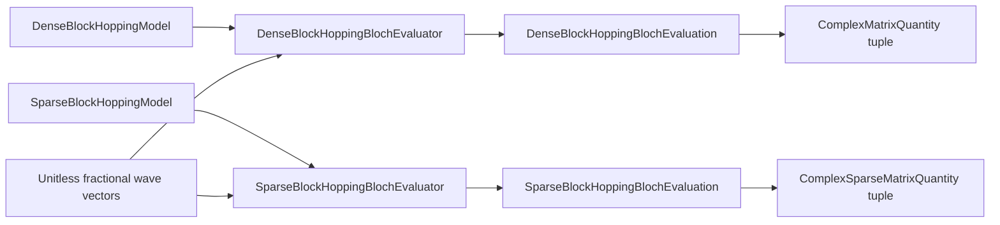

# Block-hopping Bloch schematics

## Representation-specific evaluation

Neither route silently crosses the dense–sparse boundary.

## Navigation

- [Module index](index.md)
- [Numerical contract](numerics.md)
- [Scientific contract](scientifics.md)
