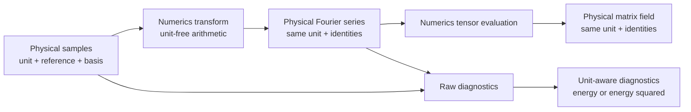

# Package `projectkoios.physkit.solidstate.tb.finite_periodic`

This package is the unit-aware physical boundary around generic finite-periodic matrix
Fourier operations.

## Current responsibility

PhysKit correlates every matrix field with one explicit energy unit, energy-reference
identity, and ordered-basis identity.

- `FinitePeriodicMatrixSamples` owns complete centered-mesh matrix samples.
- `FinitePeriodicMatrixFourierSeries` owns complete or explicitly selected matrix
  coefficients and retains their construction mesh.
- `FinitePeriodicMatrixFourierTransformResult` correlates a complete series with its
  exact source samples and backend evidence.
- `FinitePeriodicMatrixFourierEvaluation` retains tensor-grid matrix values and the
  source series' physical identities.
- Parseval diagnostics carry squared-energy units.
- Cyclic coefficient-Hermiticity defects carry the energy unit and report whether a
  Nyquist boundary exists and whether ordinary pairing covers the complete inventory.
- `take(...)` applies explicit ordered term indices but derives no physical support.
- Computed transform, evaluation, and diagnostic records can be created only by their
  owning actions, preventing manually forged results from entering the public flow.

Reduced coordinates and integer modes are dimensionless. Samples, coefficients, and
reconstructed matrices retain the source energy unit through every PhysKit record.

## Numerics boundary

Generic arithmetic delegates to the exact pinned Optimization owner.

- `CenteredUniformMesh` owns odd/even centered inventories and shifted origins.
- `NumpyCenteredUniformMeshMatrixFourierTransformer` owns the negative-sign,
  `1/N**d` forward transform.
- `NumpyTensorProductFourierMatrixSeriesEvaluator` owns bounded separable evaluation.
- `NumpyFinitePeriodicParsevalAnalyzer` owns raw Parseval reductions.
- `NumpyCenteredUniformMeshHermiticityAnalyzer` owns parity-aware cyclic pairing.
- Each diagnostic owner runs exactly once per public analyzer call; result validation
  checks units and represented relations without repeating the numerical reduction.
- PhysKit passes only dimensionless coordinates, integer modes, and raw complex
  magnitudes to Numerics, then restores physical units and identities.

## Exclusions

The module does not choose mesh sizes, coordinate shifts, support radii, cutoffs,
tolerances, locality normalization, artifact schemas, scientific interpretation, or
acceptance. Campaign owners supply those choices explicitly.

## Public API

The package façade exports these exact identities.

- `FinitePeriodicMatrixSamples`
- `FinitePeriodicMatrixFourierSeries`
- `FinitePeriodicMatrixFourierTransformResult`
- `FinitePeriodicMatrixFourierTransformer`
- `FinitePeriodicMatrixFourierEvaluation`
- `FinitePeriodicMatrixFourierTensorEvaluator`
- `FinitePeriodicMatrixParsevalDiagnostics`
- `FinitePeriodicMatrixParsevalAnalyzer`
- `FinitePeriodicMatrixHermiticityDiagnostics`
- `FinitePeriodicMatrixHermiticityAnalyzer`

## Internal organization

The public façade preserves one import surface while separating responsibilities.

- `records.py` owns source definitions, selected series, and action-created results.
- `actions.py` owns transform and tensor-evaluation delegation.
- `diagnostics.py` owns unit-aware Parseval and Hermiticity evidence.

## Local mapping

- Code: `src/python/projectkoios/physkit/solidstate/tb/finite_periodic/`
- Tests: `tests/projectkoios/physkit/solidstate/tb/finite_periodic/`

The tests cover odd and even inventories, reconstruction, physical-unit propagation,
squared Parseval units, Hermiticity-defect units, Nyquist applicability evidence,
explicit selected and empty supports, immutable storage, source bounds, action-only
result construction, single diagnostic-owner execution, and package-façade identity.
They establish bounded software and numerical behavior only.
