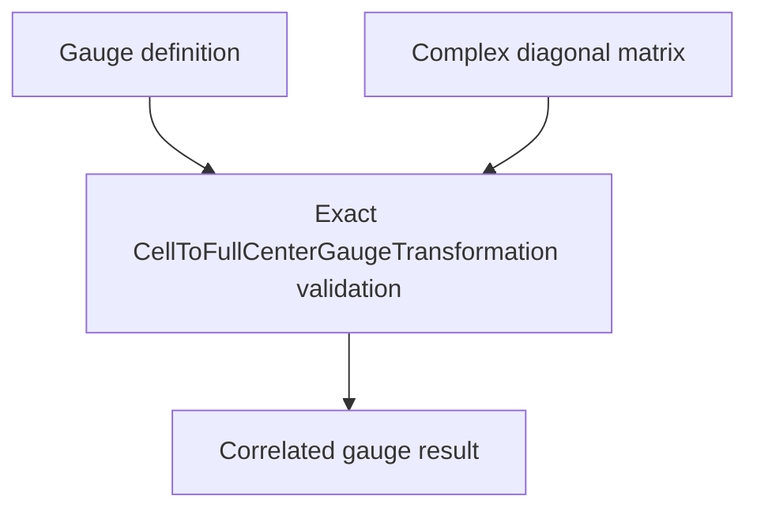

# `CellToFullCenterGaugeTransformation` schematics

Correlates one exact gauge definition with its immutable nondimensional complex diagonal matrix. The matrix shape must equal `(basis_size, basis_size)` and its unit must be the nondimensional unit-system view.

The diagram shows software ownership and validation flow only. It does not imply a
research workflow, material-selection process, or evidence-promotion path.

- [Index](index.md)
- [Numerics](numerics.md)
- [Scientific contract](scientifics.md)
