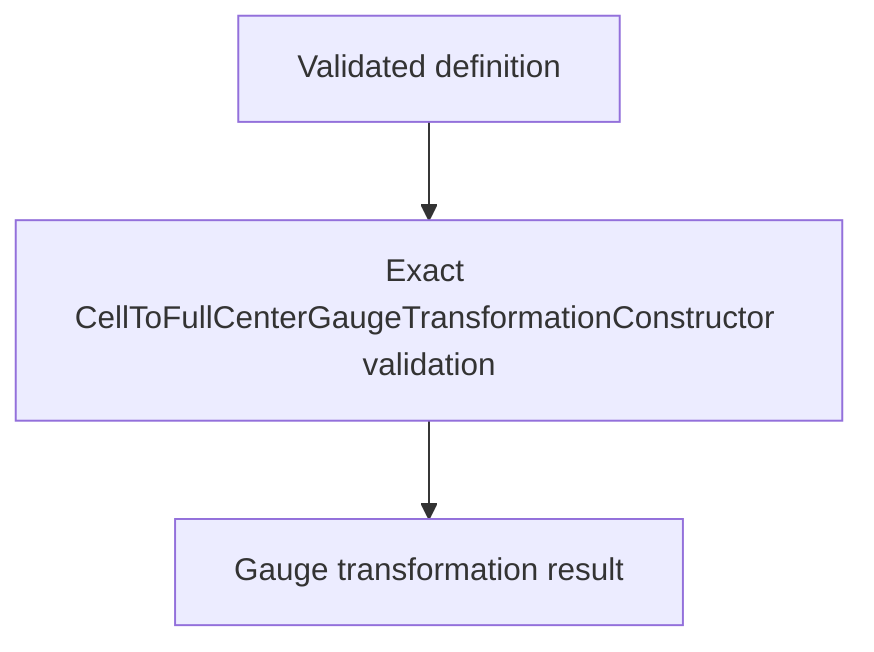

# `CellToFullCenterGaugeTransformationConstructor` schematics

Constructs the positive-phase diagonal orbital-center gauge matrix from one validated definition. The action performs a rowwise center-wave-vector contraction, vectorized complex exponential, and diagonal embedding while preserving input order.

The diagram shows software ownership and validation flow only. It does not imply a
research workflow, material-selection process, or evidence-promotion path.

- [Index](index.md)
- [Numerics](numerics.md)
- [Scientific contract](scientifics.md)
