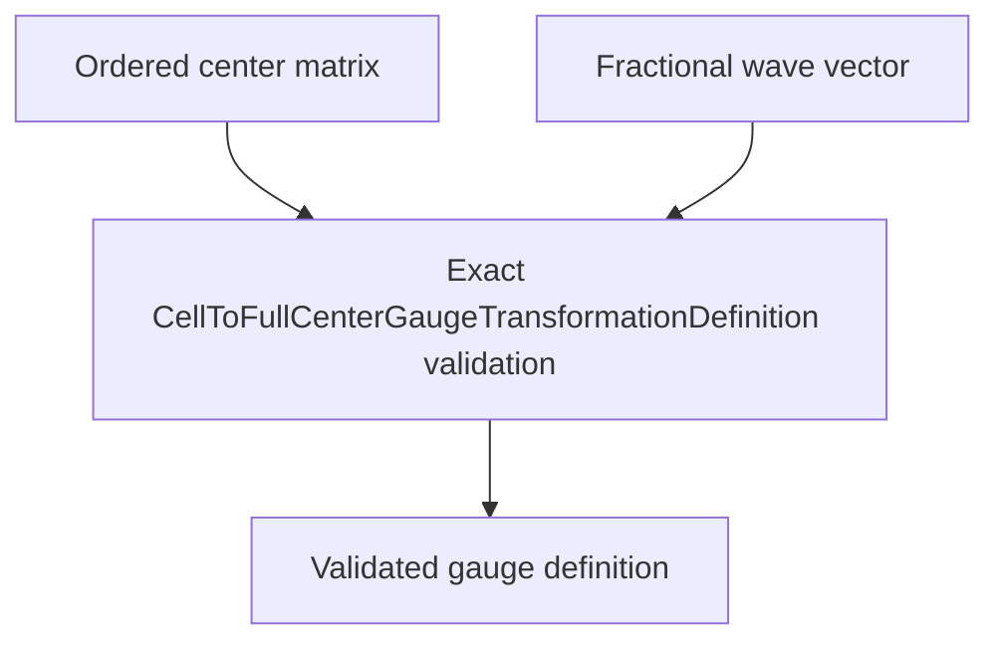

# `CellToFullCenterGaugeTransformationDefinition` schematics

Retains the exact ordered fractional orbital centers and one fractional reciprocal coordinate that define a cell-to-full-center gauge transformation. Validation is nominal, shape-exact, and unit-exact. It performs no center sorting, basis inference, dimensional projection, or reciprocal-axis permutation.

The diagram shows software ownership and validation flow only. It does not imply a
research workflow, material-selection process, or evidence-promotion path.

- [Index](index.md)
- [Numerics](numerics.md)
- [Scientific contract](scientifics.md)
