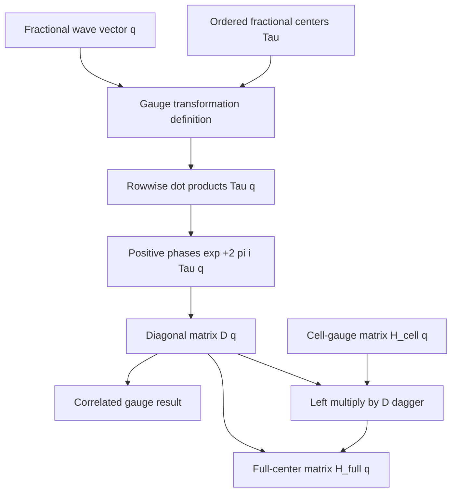

# Orbital-center gauge schematics

The ordered center rows and the represented matrix basis must refer to the same exact
coordinate order. The module retains the order supplied by the caller and performs no
sorting, center lookup, reciprocal-axis permutation, or compatibility inference.

The transformation changes representation rather than the represented operator. Both
left and right factors are required; multiplying on only one side is not a basis change.

- [Index](index.md)
- [Numerics](numerics.md)
- [Scientific contract](scientifics.md)
