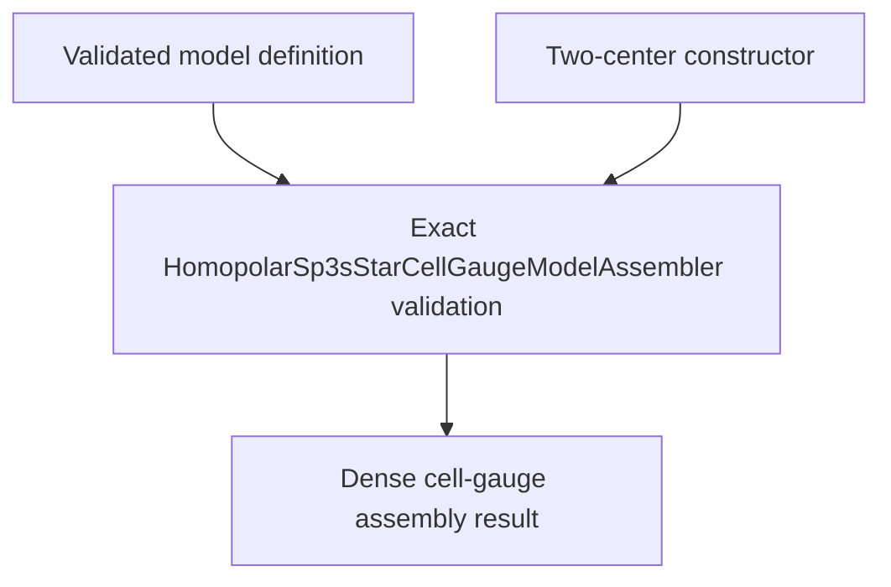

# `HomopolarSp3sStarCellGaugeModelAssembler` schematics

Embeds directed five-orbital hopping representatives and generated Hermitian reverses into sorted dense ordinary-cell coefficients. The action resolves groups exactly, accumulates into complex128 matrices, raises on nonfinite accumulation, and sorts displacement terms lexicographically.

The diagram shows software ownership and validation flow only. It does not imply a
research workflow, material-selection process, or evidence-promotion path.

- [Index](index.md)
- [Numerics](numerics.md)
- [Scientific contract](scientifics.md)
