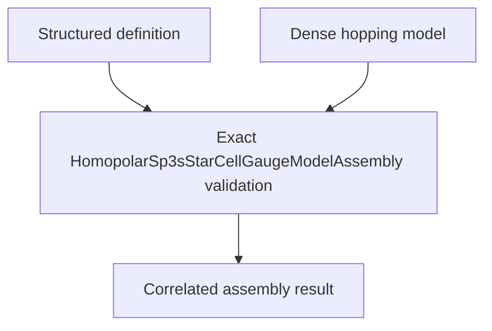

# `HomopolarSp3sStarCellGaugeModelAssembly` schematics

Correlates one exact structured model definition with its generated dense ordinary-cell block-hopping model. Model identity, dimension, energy unit, energy reference, basis metadata, and basis size must agree with the retained definition.

The diagram shows software ownership and validation flow only. It does not imply a
research workflow, material-selection process, or evidence-promotion path.

- [Index](index.md)
- [Numerics](numerics.md)
- [Scientific contract](scientifics.md)
