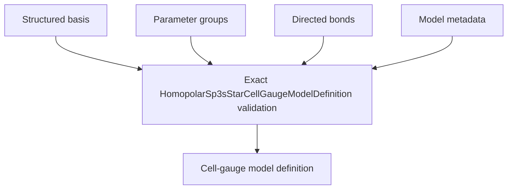

# `HomopolarSp3sStarCellGaugeModelDefinition` schematics

Correlates one exact structured basis, unique parameter groups, unique directed representatives, model identity, and energy reference. Group identifiers and directed bonds are unique, explicit reverses are absent, endpoints belong to the basis, units agree, and every group is referenced.

The diagram shows software ownership and validation flow only. It does not imply a
research workflow, material-selection process, or evidence-promotion path.

- [Index](index.md)
- [Numerics](numerics.md)
- [Scientific contract](scientifics.md)
