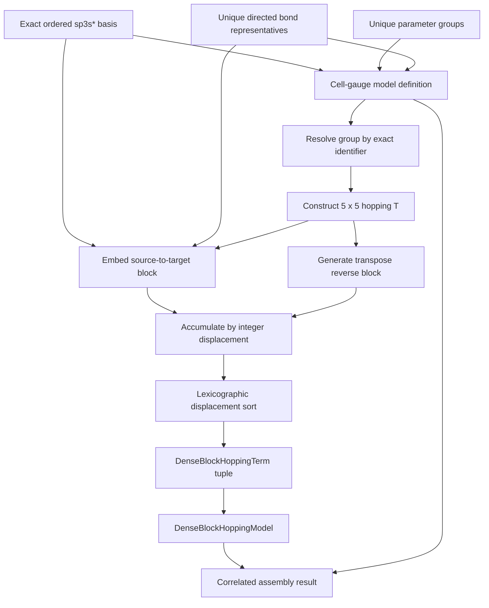

# Slater–Koster assembly schematics

Forward and reverse contributions may target the same accumulator when the ordinary
cell displacement is zero and the centers differ. Accumulation occurs before immutable
quantity construction. The generated model retains basis and energy-reference metadata,
but the structured definition remains the authoritative exact basis correlation.

- [Index](index.md)
- [Numerics](numerics.md)
- [Scientific contract](scientifics.md)
