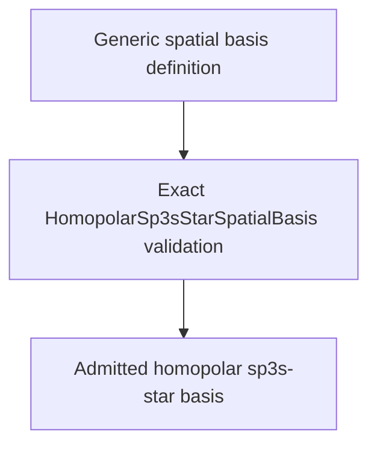

# `HomopolarSp3sStarSpatialBasis` schematics

Admits only exact ordered five-coordinate homopolar sp3s-star blocks for every center. The complete coordinate tuple must equal the generated expected tuple. Reordering, omission, insertion, or component substitution fails closed.

The diagram shows software ownership and validation flow only. It does not imply a
research workflow, material-selection process, or evidence-promotion path.

- [Index](index.md)
- [Numerics](numerics.md)
- [Scientific contract](scientifics.md)
