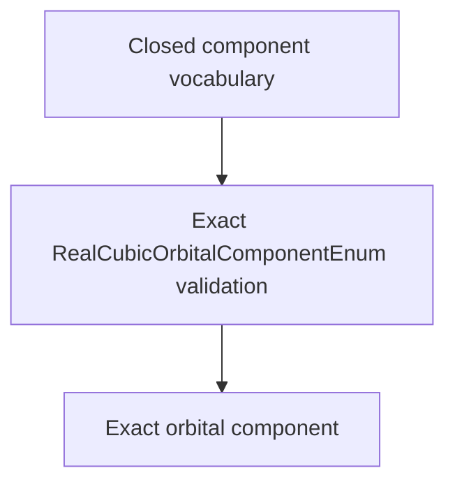

# `RealCubicOrbitalComponentEnum` schematics

Defines the closed real-cubic angular-component vocabulary admitted by generic spatial-basis coordinates. Enum membership supplies stable string values for exact records and serialization-facing labels.

The diagram shows software ownership and validation flow only. It does not imply a
research workflow, material-selection process, or evidence-promotion path.

- [Index](index.md)
- [Numerics](numerics.md)
- [Scientific contract](scientifics.md)
