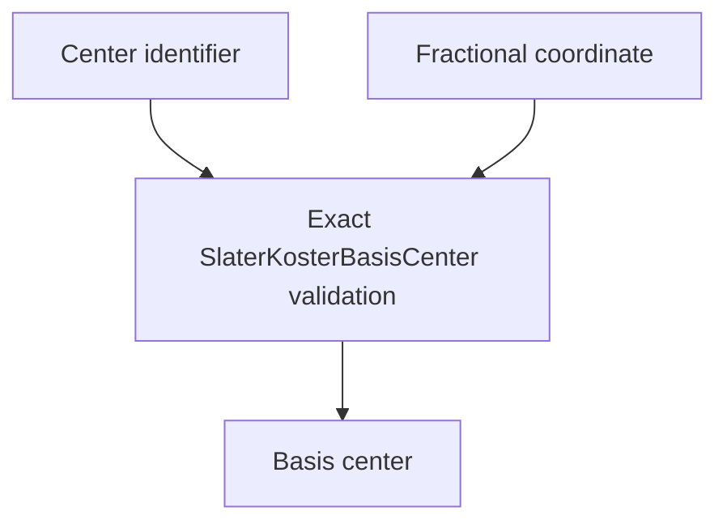

# `SlaterKosterBasisCenter` schematics

Binds one nonempty center identifier to an immutable primitive fractional coordinate. The coordinate shape is exactly `(3,)`; no Cartesian lattice basis or unit conversion is accepted at this boundary.

The diagram shows software ownership and validation flow only. It does not imply a
research workflow, material-selection process, or evidence-promotion path.

- [Index](index.md)
- [Numerics](numerics.md)
- [Scientific contract](scientifics.md)
