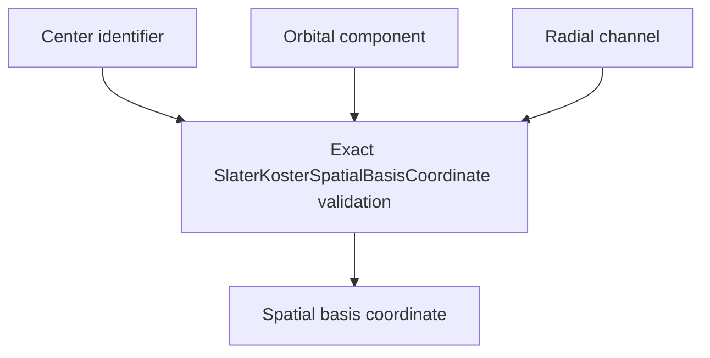

# `SlaterKosterSpatialBasisCoordinate` schematics

Identifies one ordered spin-independent spatial coordinate by center, angular component, and radial channel. Booleans, NumPy integers, negative channels, empty center labels, and arbitrary component strings are rejected.

The diagram shows software ownership and validation flow only. It does not imply a
research workflow, material-selection process, or evidence-promotion path.

- [Index](index.md)
- [Numerics](numerics.md)
- [Scientific contract](scientifics.md)
