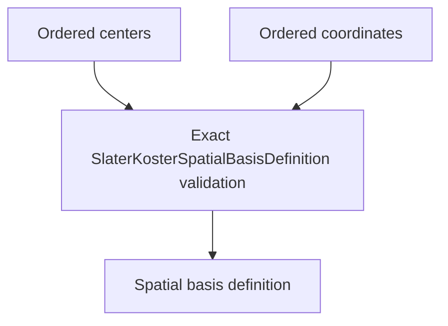

# `SlaterKosterSpatialBasisDefinition` schematics

Retains exact ordered center and coordinate tuples for one finite spatial representation. Every coordinate must reference a declared center. Equality and order are exact; dimensions and labels do not substitute for basis compatibility.

The diagram shows software ownership and validation flow only. It does not imply a
research workflow, material-selection process, or evidence-promotion path.

- [Index](index.md)
- [Numerics](numerics.md)
- [Scientific contract](scientifics.md)
