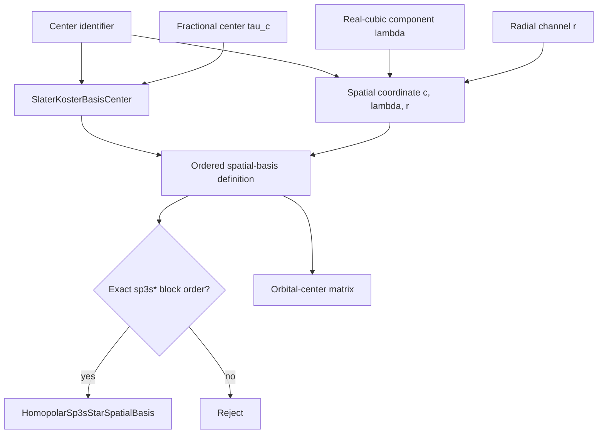

# Slater–Koster basis schematics

Center order and coordinate order are observable parts of the represented state space.
The admission step compares the complete ordered coordinate tuple; it does not infer an
$sp^3s^*$ basis from orbital count, display text, or matrix dimension. The orbital-center
matrix repeats each center coordinate for every ordered orbital attached to that center.

- [Index](index.md)
- [Numerics](numerics.md)
- [Scientific contract](scientifics.md)
