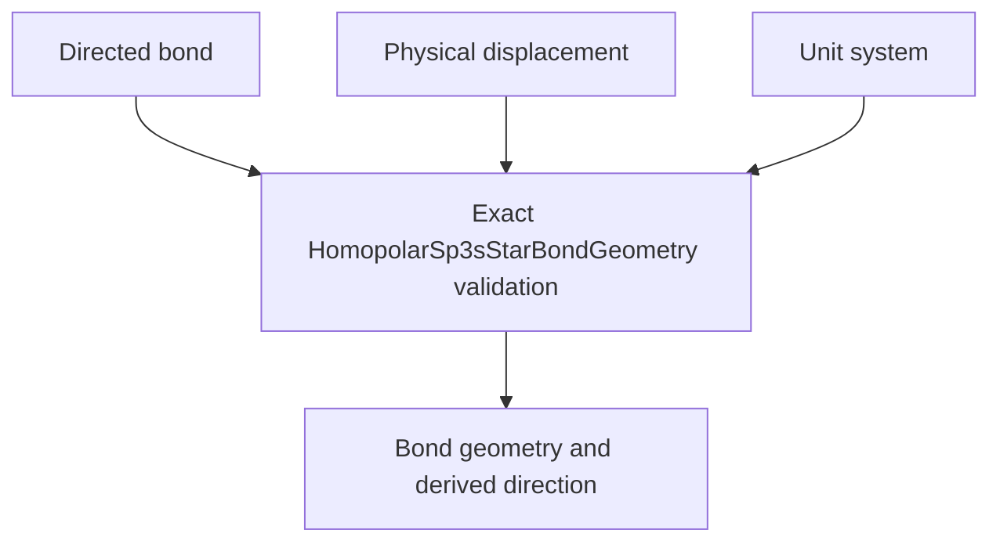

# `HomopolarSp3sStarBondGeometry` schematics

Binds a directed ordinary-cell bond to its nonzero physical Cartesian displacement and selected physical unit system. Length dimensionality, exact selected length unit, shape `(3,)`, and nonzero norm are validated before direction derivation.

The diagram shows software ownership and validation flow only. It does not imply a
research workflow, material-selection process, or evidence-promotion path.

- [Index](index.md)
- [Numerics](numerics.md)
- [Scientific contract](scientifics.md)
