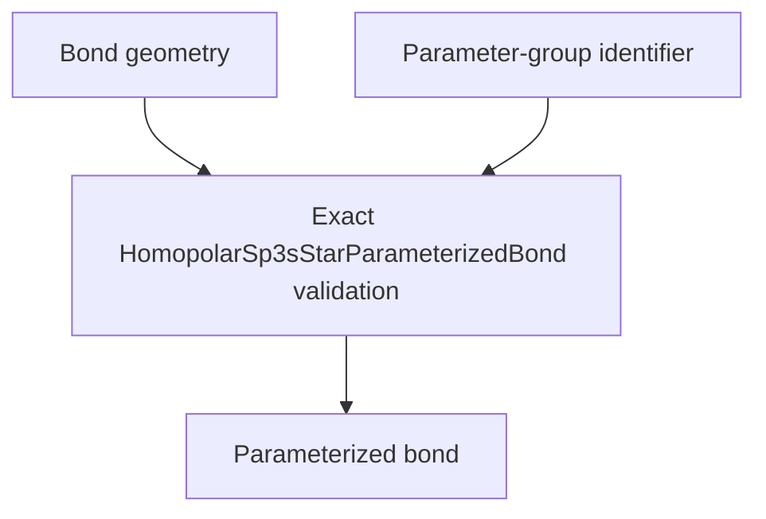

# `HomopolarSp3sStarParameterizedBond` schematics

Binds one explicit bond geometry to one nonempty parameter-group identifier. The record accepts only the exact geometry owner and a nonempty built-in string. Group resolution occurs in model-definition assembly.

The diagram shows software ownership and validation flow only. It does not imply a
research workflow, material-selection process, or evidence-promotion path.

- [Index](index.md)
- [Numerics](numerics.md)
- [Scientific contract](scientifics.md)
