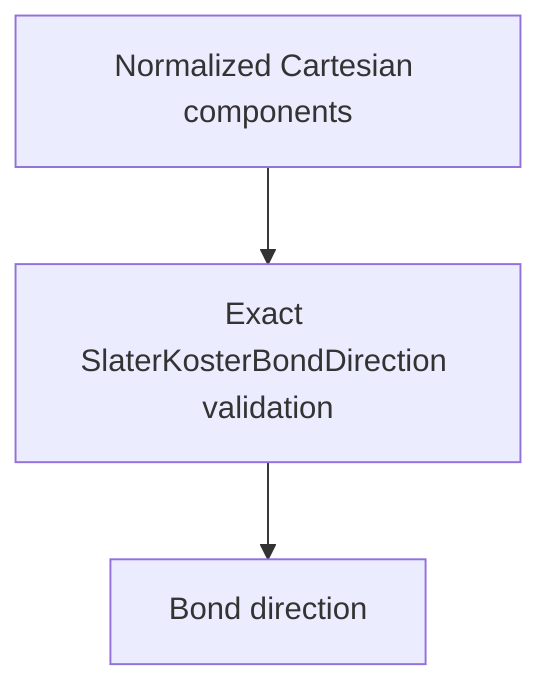

# `SlaterKosterBondDirection` schematics

Retains one normalized nondimensional Cartesian source-to-target bond direction. The Euclidean norm is checked with absolute tolerance `128 * eps`; shape and nondimensional unit are exact.

The diagram shows software ownership and validation flow only. It does not imply a
research workflow, material-selection process, or evidence-promotion path.

- [Index](index.md)
- [Numerics](numerics.md)
- [Scientific contract](scientifics.md)
