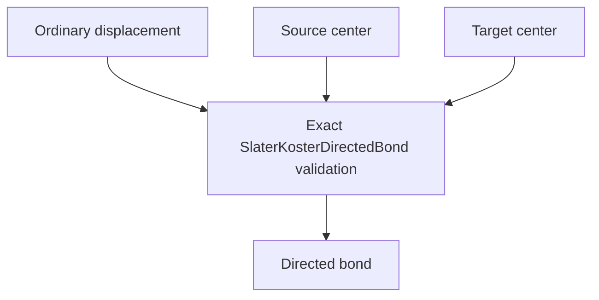

# `SlaterKosterDirectedBond` schematics

Identifies one directed three-dimensional ordinary-cell bond independently of physical Cartesian geometry. The lattice dimension must be three. A zero-displacement self block is rejected because onsite terms have separate ownership.

The diagram shows software ownership and validation flow only. It does not imply a
research workflow, material-selection process, or evidence-promotion path.

- [Index](index.md)
- [Numerics](numerics.md)
- [Scientific contract](scientifics.md)
