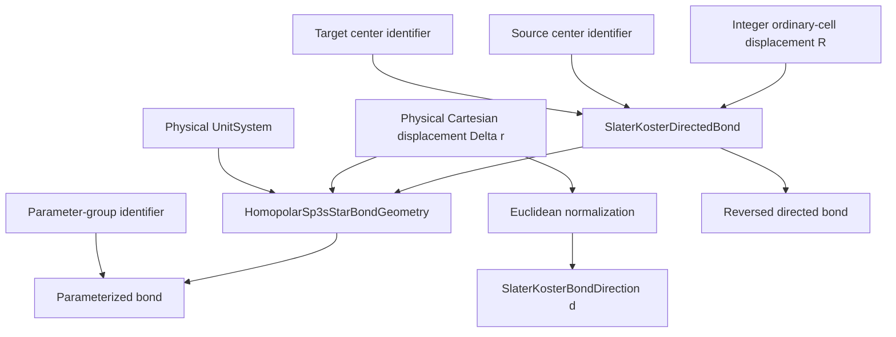

# Slater–Koster bond schematics

The ordinary displacement $R$ and physical vector $\Delta r$ remain separate inputs.
Only $R$ labels the ordinary-cell hopping coefficient. Only $\Delta r$ determines the
normalized angular direction. Reversal is a directed-bond operation; it does not mutate
or reinterpret the original record.

- [Index](index.md)
- [Numerics](numerics.md)
- [Scientific contract](scientifics.md)
