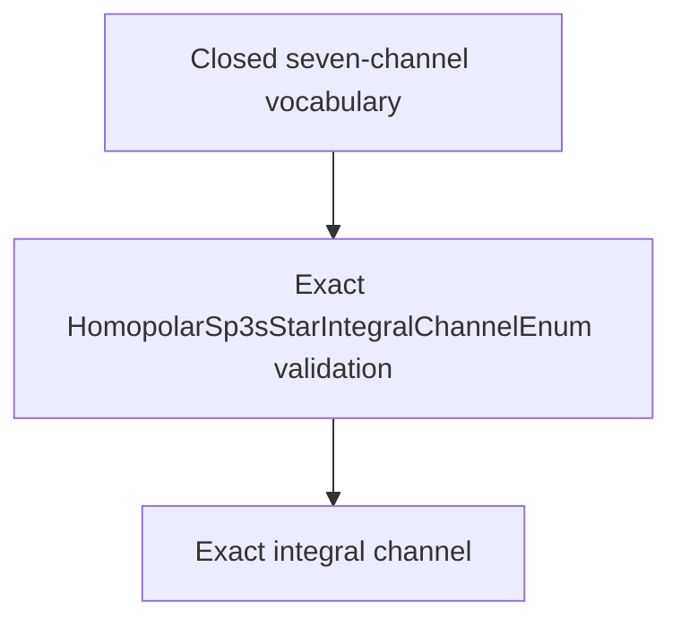

# `HomopolarSp3sStarIntegralChannelEnum` schematics

Defines the closed seven-channel vocabulary and stable order for the current homopolar sp3s-star specialization. Enum values supply stable slugs used consistently by integral names and channel-matrix lookup.

The diagram shows software ownership and validation flow only. It does not imply a
research workflow, material-selection process, or evidence-promotion path.

- [Index](index.md)
- [Numerics](numerics.md)
- [Scientific contract](scientifics.md)
