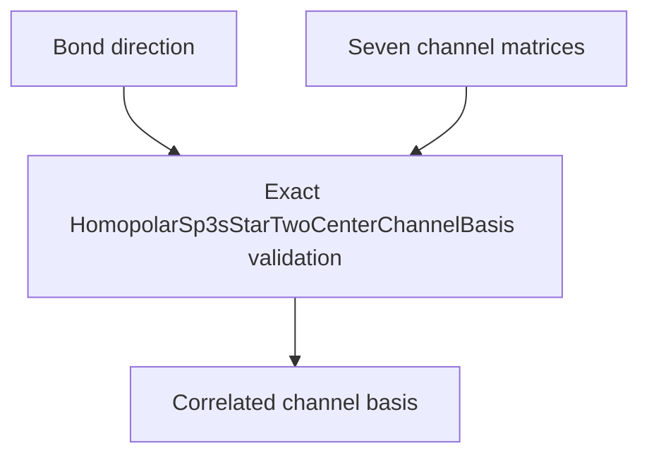

# `HomopolarSp3sStarTwoCenterChannelBasis` schematics

Correlates one normalized bond direction with seven ordered immutable nondimensional coefficient matrices. Every matrix has shape `(5, 5)` and the exact nondimensional unit. Lookup uses the stable enum order.

The diagram shows software ownership and validation flow only. It does not imply a
research workflow, material-selection process, or evidence-promotion path.

- [Index](index.md)
- [Numerics](numerics.md)
- [Scientific contract](scientifics.md)
