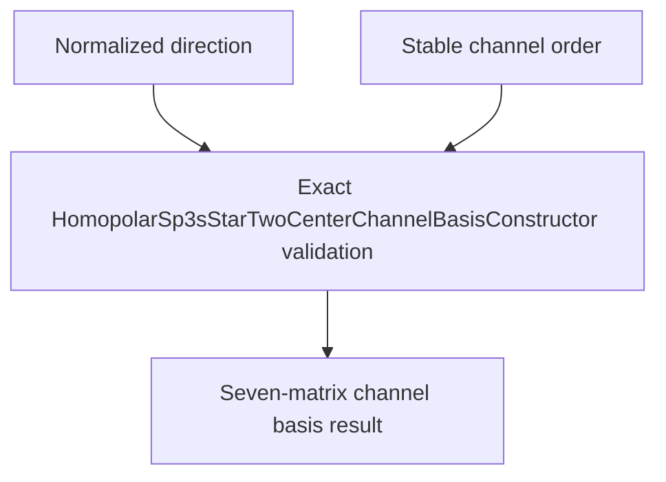

# `HomopolarSp3sStarTwoCenterChannelBasisConstructor` schematics

Constructs the seven nondimensional angular matrices in stable channel order from one normalized direction. The action uses exact channel dispatch and binary64 arrays; each branch writes only the entries owned by that channel.

The diagram shows software ownership and validation flow only. It does not imply a
research workflow, material-selection process, or evidence-promotion path.

- [Index](index.md)
- [Numerics](numerics.md)
- [Scientific contract](scientifics.md)
