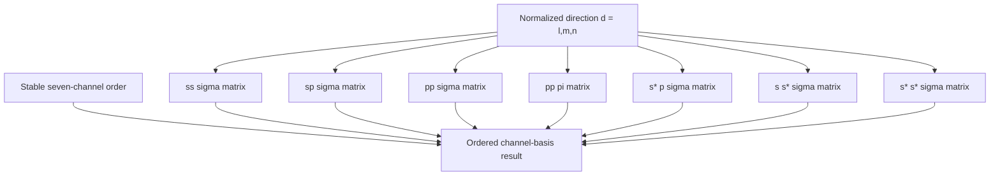

# Slater–Koster channel-basis schematics

Every branch constructs one independent coefficient matrix. The result order is the
same order used by integral records and direct hopping construction, so no string-based
channel matching or inferred shell semantics enters the linear combination.

- [Index](index.md)
- [Numerics](numerics.md)
- [Scientific contract](scientifics.md)
