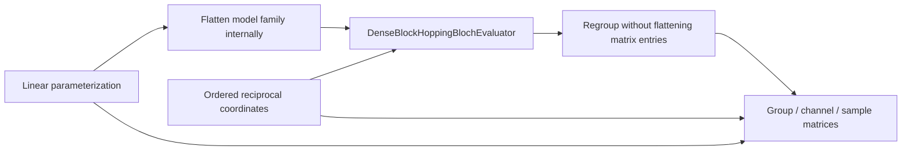

# Linear Slater–Koster Bloch schematics

Only the model-family axis is flattened for delegation. Matrix entries remain matrices,
and the returned result restores the exact group/channel nesting.

- [Index](index.md)
- [Numerics](numerics.md)
- [Scientific contract](scientifics.md)
