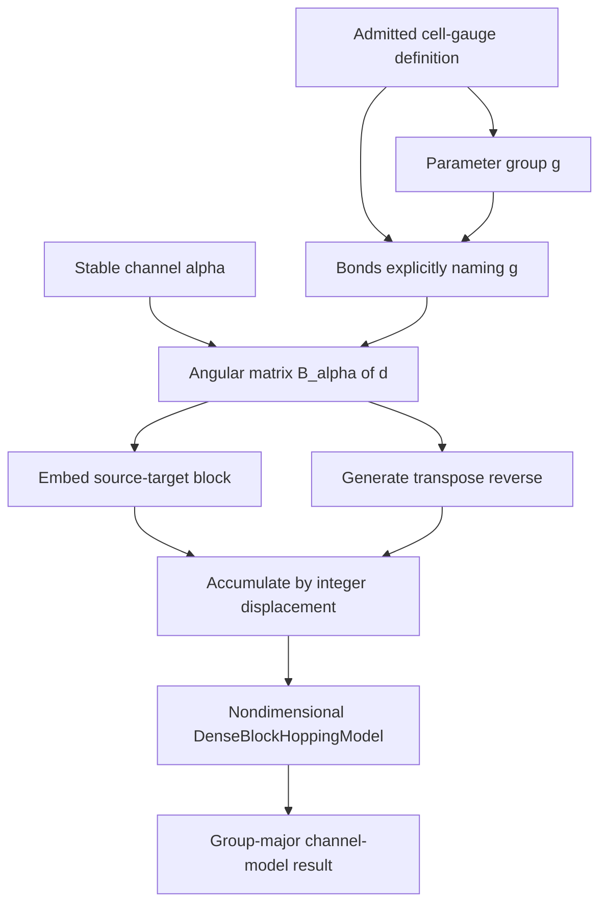

# Linear Slater–Koster parameterization schematics

Parameter values are not read during construction. Group identifiers select explicit
sharing only and never infer shell or material meaning.

- [Index](index.md)
- [Numerics](numerics.md)
- [Scientific contract](scientifics.md)
