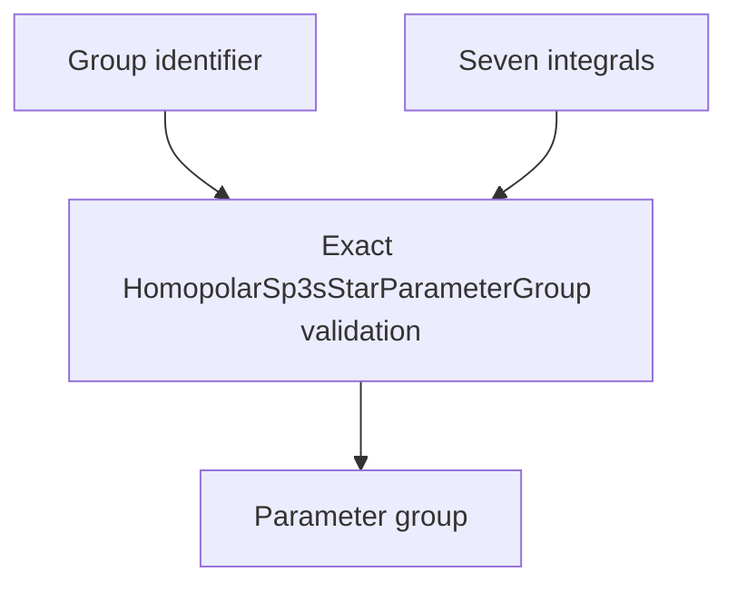

# `HomopolarSp3sStarParameterGroup` schematics

Identifies one explicitly shared immutable seven-integral parameter set. The record validates nominal ownership only; uniqueness and use of identifiers require the complete model-definition inventory.

The diagram shows software ownership and validation flow only. It does not imply a
research workflow, material-selection process, or evidence-promotion path.

- [Index](index.md)
- [Numerics](numerics.md)
- [Scientific contract](scientifics.md)
