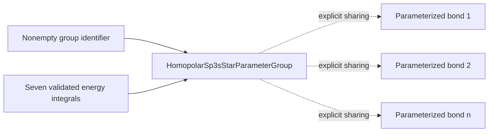

# Slater–Koster parameter-group schematics

The dotted edges denote declared reuse of one immutable integral vector. They do not
mean that the bonds share a geometric shell, length, chemical environment, or material
interpretation unless a client explicitly establishes those facts.

- [Index](index.md)
- [Numerics](numerics.md)
- [Scientific contract](scientifics.md)
