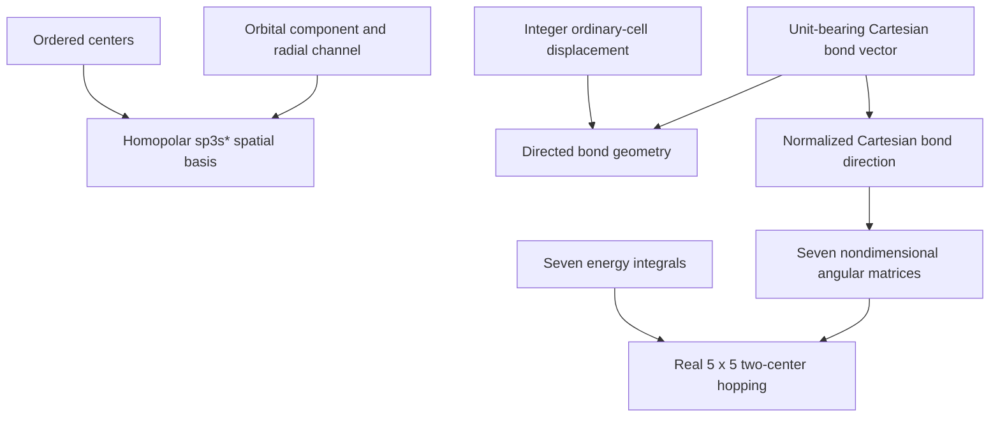

# Slater–Koster schematics

The integer displacement identifies the ordinary-cell translation. The Cartesian
bond vector alone determines the normalized direction; center offsets are never folded into
the integer displacement.

- [Index](index.md)
- [Numerics](numerics.md)
- [Scientific contract](scientifics.md)
