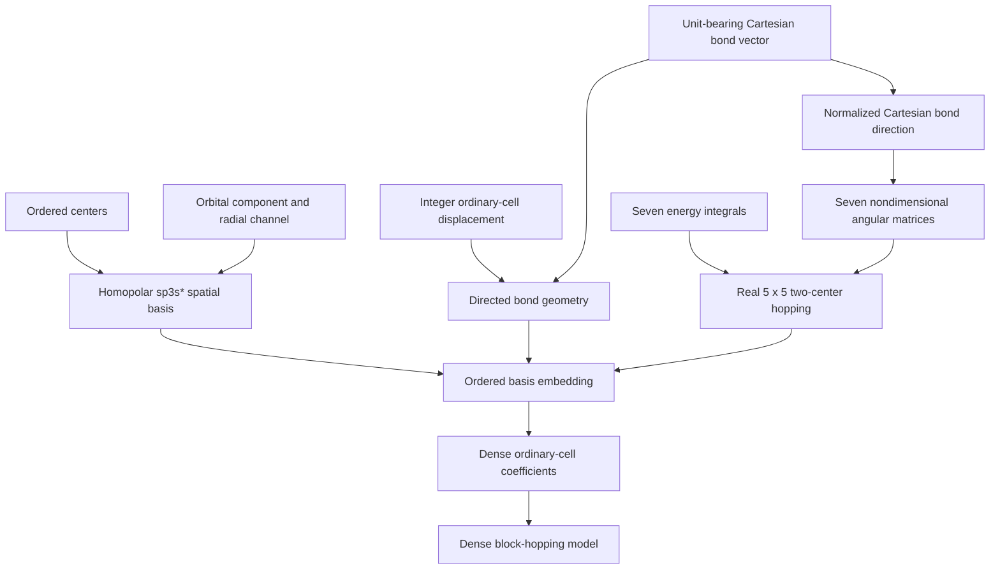

# Slater–Koster schematics

The integer displacement identifies the ordinary-cell translation. The Cartesian
bond vector alone determines the normalized direction; center offsets are never folded
into the integer displacement. Assembly adds the source-to-target block at the declared
displacement and its transpose at the reversed displacement. It does not add onsite
terms or evaluate Bloch phases.

- [Index](index.md)
- [Numerics](numerics.md)
- [Scientific contract](scientifics.md)
