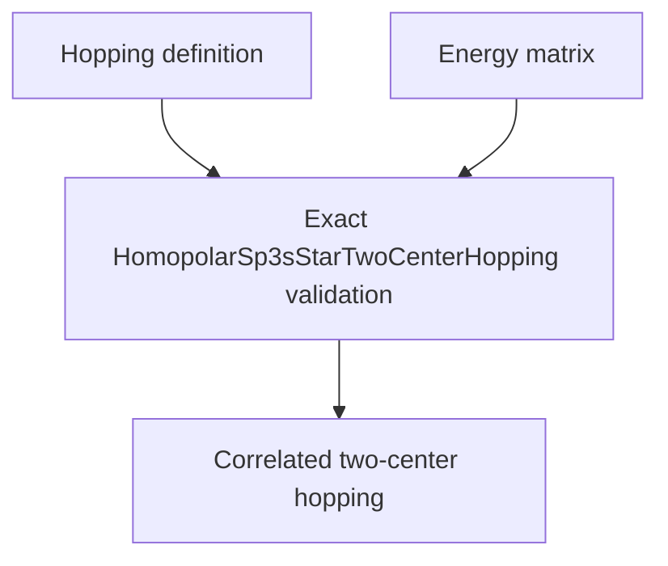

# `HomopolarSp3sStarTwoCenterHopping` schematics

Correlates one exact two-center definition with its immutable real five-orbital energy matrix. The matrix shape and energy unit must match the definition integrals exactly. The fixed orbital order is exposed explicitly.

The diagram shows software ownership and validation flow only. It does not imply a
research workflow, material-selection process, or evidence-promotion path.

- [Index](index.md)
- [Numerics](numerics.md)
- [Scientific contract](scientifics.md)
