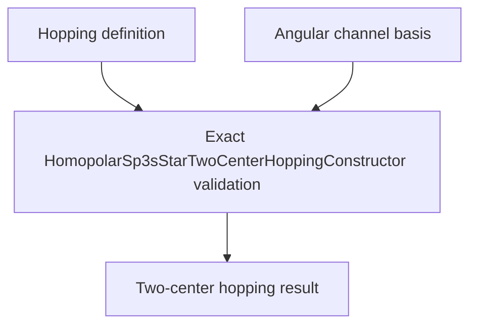

# `HomopolarSp3sStarTwoCenterHoppingConstructor` schematics

Constructs one energy-valued two-center matrix by ordered linear combination of the seven angular channel matrices. Binary64 accumulation is checked for nonfinite output. Overflow raises rather than clipping or silently regularizing values.

The diagram shows software ownership and validation flow only. It does not imply a
research workflow, material-selection process, or evidence-promotion path.

- [Index](index.md)
- [Numerics](numerics.md)
- [Scientific contract](scientifics.md)
