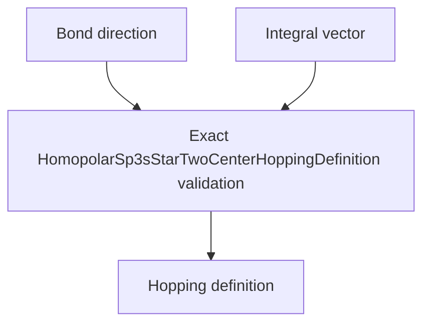

# `HomopolarSp3sStarTwoCenterHoppingDefinition` schematics

Binds one source-to-target bond direction to one exact seven-integral set. Both values require exact nominal owners. The definition performs no geometric or material inference.

The diagram shows software ownership and validation flow only. It does not imply a
research workflow, material-selection process, or evidence-promotion path.

- [Index](index.md)
- [Numerics](numerics.md)
- [Scientific contract](scientifics.md)
