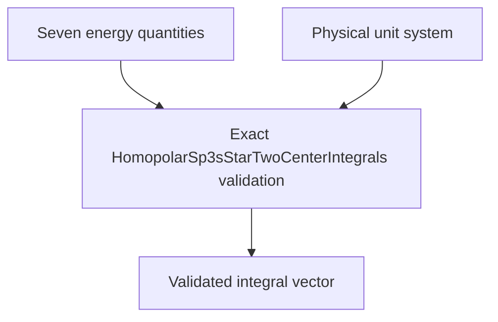

# `HomopolarSp3sStarTwoCenterIntegrals` schematics

Retains seven real physical energy quantities in stable homopolar sp3s-star channel order. Every scalar must carry a physical energy unit, all units must match exactly, and that unit must equal the selected system energy unit.

The diagram shows software ownership and validation flow only. It does not imply a
research workflow, material-selection process, or evidence-promotion path.

- [Index](index.md)
- [Numerics](numerics.md)
- [Scientific contract](scientifics.md)
