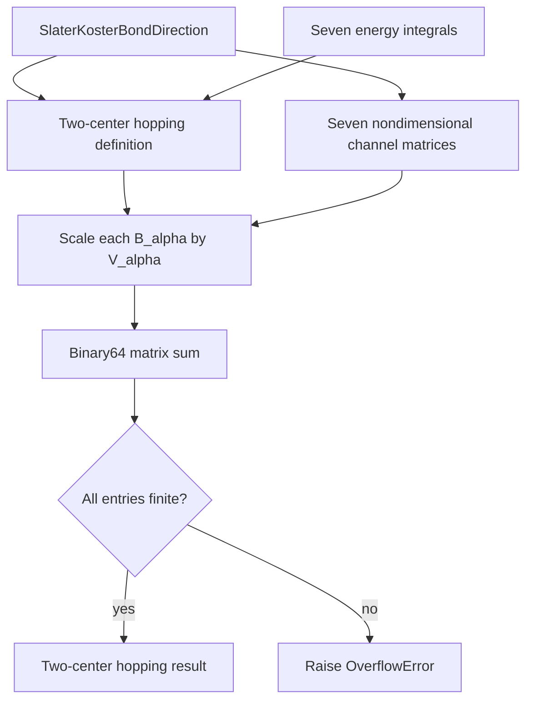

# Homopolar $sp^3s^*$ hopping schematics

The constructor delegates angular placement to the channel-basis owner and performs one
ordered linear reduction. It does not infer absent channels: a missing physical
interaction is represented by an explicit zero-valued energy quantity.

- [Index](index.md)
- [Numerics](numerics.md)
- [Scientific contract](scientifics.md)
