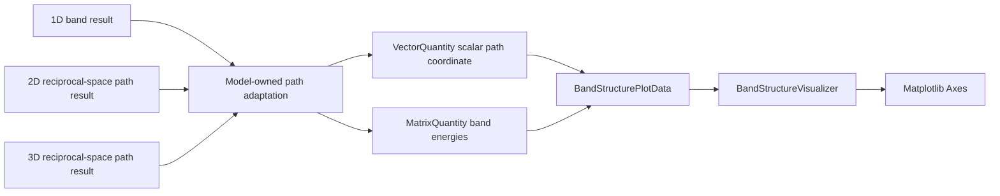
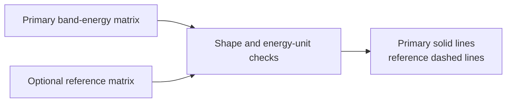

# Solid-state visualization schematics

## Dimension-independent band rendering

The visualizer consumes a scalar parameterization of an already selected path.
It does not inspect the dimension of the reciprocal vectors used to construct
that path.

## Optional reference overlay

Notebook or model code owns the scientific meaning of the reference, such as an
exact free-particle spectrum or a convergence baseline.

## Navigation

- [Package index](index.md)
- [Numeric contract](numeric.md)
- [Scientific contract](scientific.md)
